# Toxic Comment Classification with BERT: Transfer Learning, Fine-Tuning, Hyperparameter Tuning and Interpretability

**Name:** Redowanul Akbar
**Student ID:** 1000129290

Assignment 03, Skills for Industry Competitiveness and Innovation Program (SICIP), BRAC University.

## 1. Task

Given a user comment, predict whether it is **toxic** or **not toxic**. The classifier is trained and evaluated on the Civil Comments dataset (`google/civil_comments`) and then tested on a set of real-world sentences.

The pipeline has four parts:

1. **Transfer learning (frozen baseline).** A pre-trained BERT-based encoder is used only as a frozen feature extractor. Mean-pooled embeddings feed a logistic regression classifier. No encoder weight is updated.
2. **Fine-tuning.** The whole encoder is unfrozen and trained end-to-end together with a classification head, first with default hyperparameters.
3. **Hyperparameter tuning.** The fine-tuned model is tuned with Optuna, then retrained on the full training subset with the best setting.
4. **Interpretability.** Individual predictions are explained with SHAP.

## 2. Dataset and labels

- Source: `load_dataset("google/civil_comments")`. The comment is in `text` and `toxicity` is a score between 0 and 1 (the fraction of annotators who rated the comment toxic).
- **Threshold: a comment is labelled toxic when `toxicity >= 0.5`, otherwise not toxic.** This matches the majority-vote definition used in the original Jigsaw challenge.
- Because of compute limits I used random subsets instead of the full 1.8M training comments:
  - train: sampled from the official train split, with 30% toxic comments so the model sees enough positive examples (only about 8% of comments are toxic in the full data);
  - validation and test: random samples from the official validation and test splits, keeping the natural class balance.
- Empty comments are removed. Texts are truncated to 128 tokens; most comments are shorter than that.

<!-- AUTO:SETUP:START -->
Run settings: model `distilbert-base-uncased`, max length 128 tokens, toxicity threshold **0.5**, seed 42, device `cuda`.

| split | rows | toxic | non_toxic | toxic (%) | avg_words |
|---|---|---|---|---|---|
| train | 40000 | 12000 | 28000 | 30.00 | 50.50 |
| validation | 5000 | 407 | 4593 | 8.14 | 52.00 |
| test | 10000 | 812 | 9188 | 8.12 | 51.40 |

The training subset was sampled with 30% toxic comments. Validation and test keep the natural class balance of Civil Comments, so the test numbers reflect the real distribution.

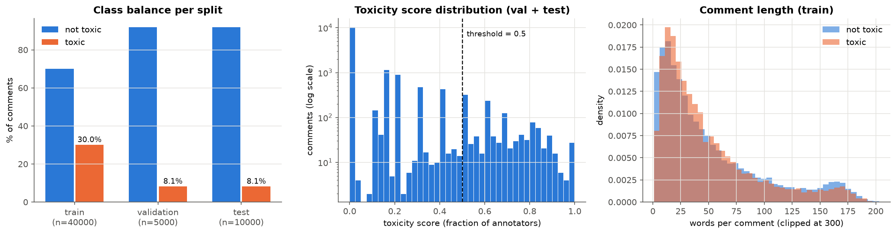
<!-- AUTO:SETUP:END -->

## 3. Model choice

I used **`distilbert-base-uncased`**.

- It is a BERT-based model: DistilBERT is a compressed version of BERT-base trained by knowledge distillation, with the same tokenizer and the same kind of contextual embeddings.
- It keeps around 97% of BERT-base's language understanding performance (GLUE) with 40% fewer parameters (66M vs 110M) and runs about 60% faster. That matters here because the pipeline fine-tunes the model many times during hyperparameter search.
- The uncased variant fits this data. Online comments use capital letters inconsistently, so case carries little signal and lowercasing reduces vocabulary fragmentation.
- It is small enough to fine-tune on a free Colab GPU or a laptop GPU, so the whole pipeline is reproducible.

The model name is a single setting in `src/config.py` (`model_name`), so `bert-base-uncased` or another BERT-family model can be swapped in without code changes.

## 4. Method

### 4.1 Frozen baseline (transfer learning)

- The encoder is loaded, put in eval mode and every parameter has `requires_grad = False`.
- Each comment is encoded once. The last hidden states are mean-pooled over the real (non-padding) tokens to give a 768-dimensional vector.
- A standardised logistic regression (C = 1.0, no tuning) is trained on these vectors. This is the baseline before any hyperparameter tuning.

### 4.2 Fine-tuning

- `AutoModelForSequenceClassification` with two labels; all layers trainable.
- AdamW, linear learning-rate schedule with warmup, gradient clipping at 1.0, mixed precision on GPU.
- Default (untuned) setting: learning rate 2e-5, batch size 16, 2 epochs, weight decay 0.01, warmup ratio 0.1.
- After each epoch the model is scored on the validation set and the best epoch (by validation PR-AUC) is kept.

### 4.3 Hyperparameter tuning

- Optuna, TPE sampler, median pruner, objective = validation PR-AUC.
- PR-AUC is used as the objective because the validation set is imbalanced (around 8% toxic). Accuracy would look high even for a model that predicts "not toxic" for everything, and PR-AUC does not depend on a single decision threshold.
- The search space covers the settings that matter most when fine-tuning transformers: learning rate (log scale), batch size, number of epochs, weight decay and warmup ratio.

### 4.4 Evaluation

All three models are evaluated on the same held-out test set with accuracy, precision, recall, F1 (toxic class), macro F1, ROC-AUC and PR-AUC. Results are reported at the default 0.5 threshold and at the F1-optimal threshold chosen on the validation set (never on the test set).

## 5. Results: without tuning vs with tuning

<!-- AUTO:RESULTS:START -->
**Test set, decision threshold 0.5**

| model | accuracy | precision | recall | f1 | macro_f1 | roc_auc | pr_auc |
|---|---|---|---|---|---|---|---|
| Frozen baseline | 0.8847 | 0.3685 | 0.5887 | 0.4533 | 0.6944 | 0.8714 | 0.4867 |
| Fine-tuned (default) | 0.9122 | 0.4764 | 0.8214 | 0.6031 | 0.7769 | 0.9528 | 0.7424 |
| Fine-tuned (tuned) | 0.9123 | 0.4768 | 0.8239 | 0.6041 | 0.7774 | 0.9519 | 0.7434 |

**Test set, F1-optimal threshold picked on the validation set**

| model | accuracy | precision | recall | f1 | macro_f1 | roc_auc | pr_auc | threshold |
|---|---|---|---|---|---|---|---|---|
| Frozen baseline | 0.9089 | 0.4433 | 0.4766 | 0.4593 | 0.7048 | 0.8714 | 0.4867 | 0.6347 |
| Fine-tuned (default) | 0.9474 | 0.6740 | 0.6823 | 0.6781 | 0.8247 | 0.9528 | 0.7424 | 0.9136 |
| Fine-tuned (tuned) | 0.9462 | 0.6631 | 0.6860 | 0.6743 | 0.8225 | 0.9519 | 0.7434 | 0.9071 |

| model | trainable parameters | training time (s) |
|---|---|---|
| Frozen baseline | 769 (logistic regression only) | 127.6 |
| Fine-tuned (default) | 66,955,010 | 503.2 |
| Fine-tuned (tuned) | 66,955,010 | 508.8 |

Measured differences on the test set (threshold 0.5):

- Fine-tuning vs frozen baseline: F1 +0.150, ROC-AUC +0.081, PR-AUC +0.256.
- Tuned vs default fine-tuning: F1 +0.001, ROC-AUC -0.001, PR-AUC +0.001.
- Tuned model vs frozen baseline: F1 +0.151, PR-AUC +0.257.

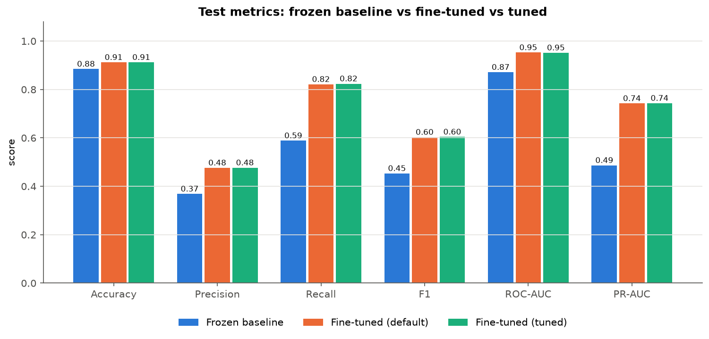

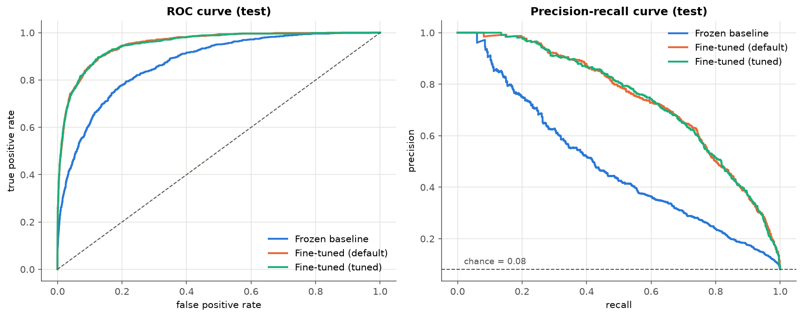

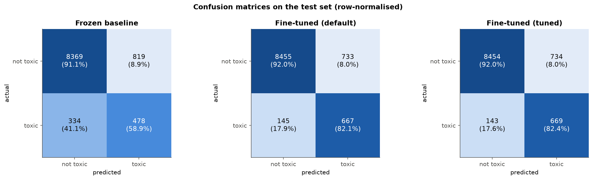

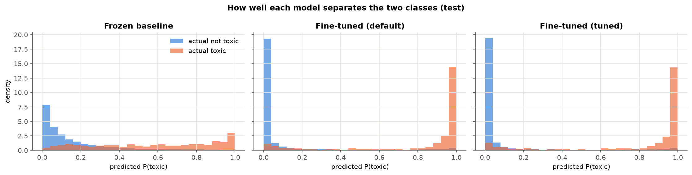

Training curves:

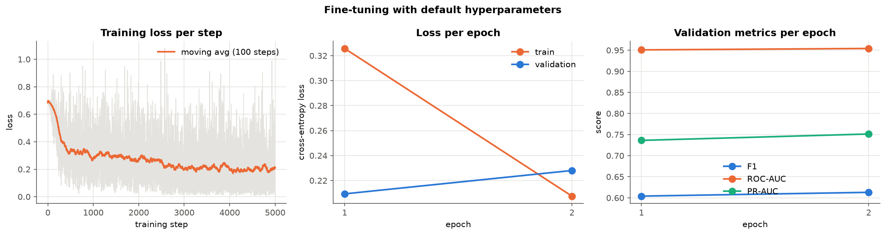

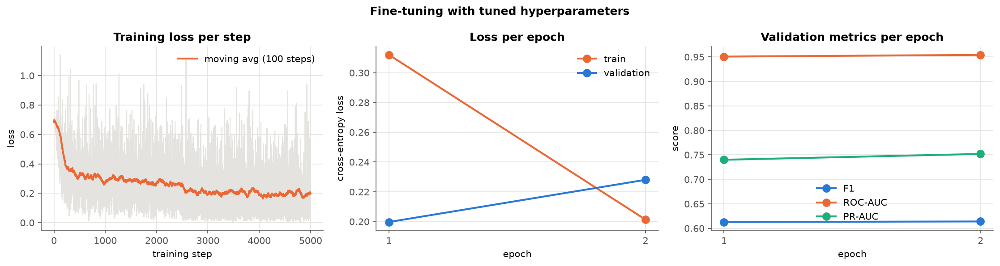

Frozen embeddings (t-SNE). The two classes overlap heavily, which is why a linear classifier on frozen features has limited room:

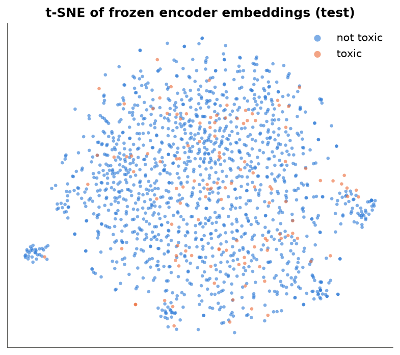
<!-- AUTO:RESULTS:END -->

### Justification of the results

**Frozen baseline vs fine-tuned model.** Fine-tuning gave the largest improvement in the whole pipeline. At threshold 0.5, F1 rose from 0.453 to 0.603, ROC-AUC from 0.871 to 0.953 and PR-AUC from 0.487 to 0.742. Recall on the toxic class went from 0.589 to 0.821 and precision from 0.369 to 0.476, so the fine-tuned model catches more toxic comments while also raising fewer false alarms.

The reason is what each model is allowed to learn. The frozen encoder was pre-trained on masked language modelling over books and Wikipedia. Its embeddings describe the general meaning and topic of a sentence, but nothing in that objective asks it to separate abusive language from strong but civil language. A comment that criticises a politician and a comment that insults another user can end up close together in embedding space, and the t-SNE plot shows the two classes mixed together. A logistic regression on fixed features can only draw one linear boundary through that space, and with 769 trainable parameters it cannot change the features themselves.

Fine-tuning updates all 66.9M parameters. The gradient from the classification loss reaches every transformer layer, so the encoder learns which words and which contexts make a comment toxic. The probability distribution plot shows the effect: after fine-tuning, toxic and non-toxic comments are pushed much further apart. The cost is training time: about 500 seconds per fine-tuning run against about 130 seconds for the baseline, most of which is spent extracting embeddings.

**Default fine-tuning vs tuned fine-tuning.** Tuning made almost no difference on the test set: F1 +0.001, ROC-AUC -0.001, PR-AUC +0.001. At the validation-chosen threshold the tuned model is even slightly lower (F1 0.674 vs 0.678). These differences are far smaller than the run-to-run noise of fine-tuning, so the two models should be treated as equal.

There are three reasons for this.

1. The default setting was already close to the best one. The best trial chose learning rate 2.26e-5 (default 2e-5), batch size 16 and 2 epochs, the same as the default. Only weight decay (0.061 vs 0.01) and warmup ratio (0.034 vs 0.1) changed.
2. The gain the search found came from the small tuning subset. On the 8,000-comment subset, the best trial beat the default by 0.014 PR-AUC (0.682 vs 0.668). The two settings that changed, weight decay and warmup, are regularisation settings. They matter when training data is small and the model is at risk of overfitting. With the full 40,000-comment training set, that risk is lower and the advantage disappears.
3. The search was short. Median pruning stopped 8 of the 12 trials early, so only 4 trials completed. Optuna computes parameter importance from completed trials, so the importance plot (weight decay 0.55, warmup 0.32, learning rate 0.13) is based on very few points and should not be read as a general rule.

The main conclusion is that for this task the large gain comes from unfreezing the model, not from tuning it. The commonly recommended defaults for BERT-style models (learning rate around 2e-5, 2 to 3 epochs) were already a good choice.

**Threshold.** The training subset has 30% toxic comments while the test set has 8.1%, so the fine-tuned models give higher toxic probabilities than the real base rate. As a result the F1-optimal thresholds chosen on validation are high: about 0.91 for both fine-tuned models, against 0.63 for the baseline. Moving the threshold from 0.5 to 0.91 raised precision from 0.476 to 0.674 while recall dropped from 0.821 to 0.682, and F1 improved from 0.603 to 0.678. Which threshold to use depends on the application. A moderation queue that a human reviews can use the lower threshold to catch more toxic comments, while automatic removal should use the higher one to avoid wrongly removing comments.

## 6. Hyperparameter tuning results

<!-- AUTO:TUNING:START -->
| hyperparameter | search range |
|---|---|
| learning_rate | 1e-05 to 6e-05 (log scale) |
| batch_size | one of 16, 32 |
| epochs | one of 1, 2, 3 |
| weight_decay | 0 to 0.1 |
| warmup_ratio | 0 to 0.2 |

Method: Optuna with the TPE sampler, 12 trials, median pruning after each epoch, objective = validation PR-AUC. Each trial fine-tunes on a 8000-comment subset of the training data to keep the search affordable. Trial 0 is the default setting, so the search is measured against it.

Completed trials: 4, pruned: 8. Default setting (trial 0) scored 0.6683; the best trial scored 0.6823.

| best hyperparameter | value |
|---|---|
| learning_rate | 2.26e-05 |
| batch_size | 16 |
| epochs | 2 |
| weight_decay | 0.0608 |
| warmup_ratio | 0.0341 |

Parameter importance (fANOVA): weight_decay (0.55), warmup_ratio (0.32), learning_rate (0.13), epochs (0.00), batch_size (0.00).

Screenshot of the tuning results:

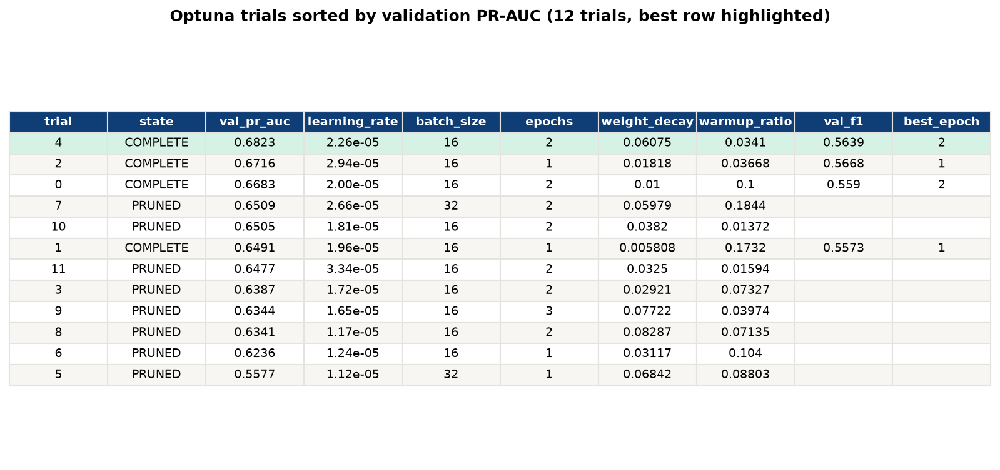

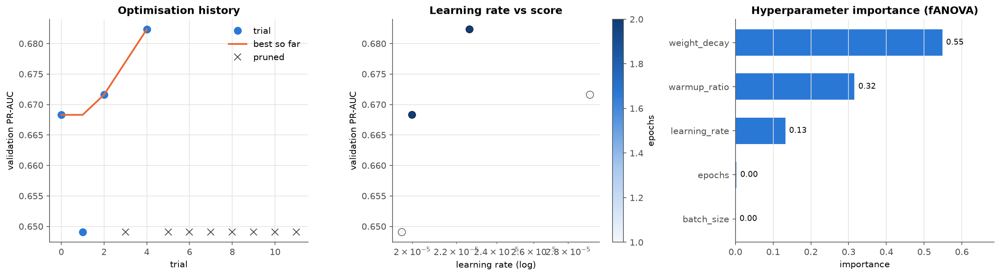
<!-- AUTO:TUNING:END -->

## 7. Test on real-world text

The real-world sentences were written in the style of comments from news sites, forums and social media. They include clear insults, polite comments, strong criticism that is not toxic, and sentences that contain "violent" words in a harmless idiom (for example "I killed it at my presentation"). These last cases check whether the model reacts to single words or to context.

<!-- AUTO:REALWORLD:START -->
Model: tuned fine-tuned model, decision threshold 0.907 (chosen on validation). The texts are in `data/real_world_texts.csv`; the expected label is my own judgement of each sentence.

| text | source | prob_toxic | predicted_class | expected | check |
|---|---|---|---|---|---|
| Thanks for the detailed explanation, this cleared up a lot of my confusion about the new tax rules. | news site comment | 0.001 | not toxic | not toxic | correct: polite and appreciative |
| I respectfully disagree with the mayor. The budget cuts will hurt public schools the most. | news site comment | 0.001 | not toxic | not toxic | correct: political disagreement without insults |
| The traffic on the Dhaka-Chittagong highway was terrible again today, took me six hours. | social media post | 0.002 | not toxic | not toxic | correct: complaint about traffic; negative but not toxic |
| This article is badly researched and the author clearly did not check the numbers. | news site comment | 0.003 | not toxic | not toxic | correct: harsh criticism of work rather than a person |
| You are an absolute idiot if you believe this nonsense. | social media reply | 0.997 | toxic | toxic | correct: direct insult aimed at another user |
| Shut up, nobody cares about your stupid opinion. | forum reply | 0.997 | toxic | toxic | correct: dismissive insult |
| People like you are the reason this country is going to hell. Pathetic. | news site comment | 0.997 | toxic | toxic | correct: hostile and demeaning toward a group |
| What a moron. Go back to school before you post again. | social media reply | 0.997 | toxic | toxic | correct: name-calling |
| I killed it at my presentation today, the whole team loved it! | social media post | 0.406 | not toxic | not toxic | correct: violent word used in a positive idiom |
| This movie was so bad it was hilarious, I laughed the whole time. | review site | 0.004 | not toxic | not toxic | correct: negative words without toxicity |
| Get lost, you worthless troll. | forum reply | 0.996 | toxic | toxic | correct: insult and name-calling |
| The referee was blind tonight, worst officiating I have seen all season. | sports forum | 0.013 | not toxic | not toxic | correct: strong criticism; borderline but generally not toxic |

12 of 12 predictions agree with the expected label.

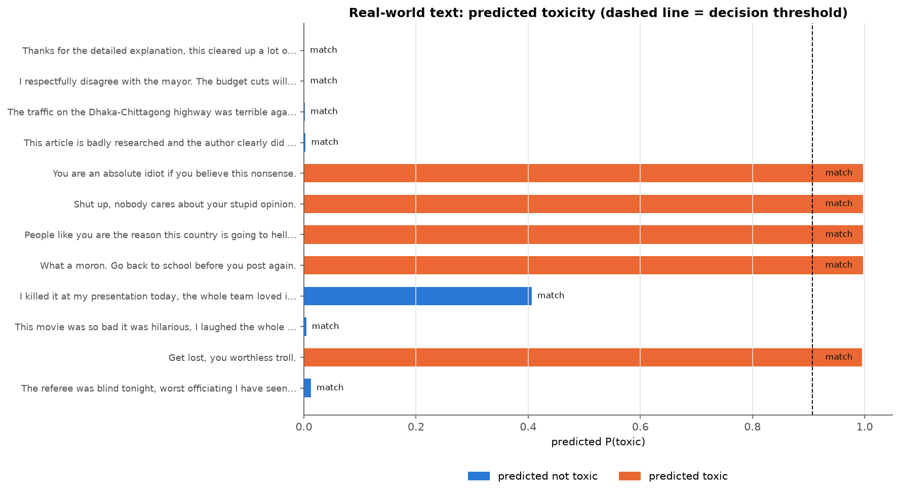
<!-- AUTO:REALWORLD:END -->
All 12 real-world sentences were classified as expected. The clear insults scored above 0.99 and the polite or merely negative comments scored below 0.02. Two sentences stand out:

- **"I killed it at my presentation today, the whole team loved it!"** scored 0.406. That is far below the 0.907 threshold, and still below 0.5, so the prediction is correct. Even so, it is the least certain prediction by a wide margin: the word "killed" alone pushes the model towards toxic, even though the rest of the sentence makes the meaning clearly positive.
- **"The referee was blind tonight, worst officiating I have seen all season."** scored 0.013. SHAP shows "worst" pushing slightly towards toxic, but the sports context (referee, officiating, season) outweighs it.

Twelve hand-written sentences are not a measure of accuracy. They do show that the model handles harsh criticism of things, as opposed to insults directed at people, reasonably well, and that its main weakness is single strong words.
## 8. Explainability analysis

### Method: SHAP

I used **SHAP (SHapley Additive exPlanations)** with its text masker.

- SHAP hides groups of tokens, runs the model again, and measures how much the toxic probability changes. The contributions are Shapley values, so for each comment they add up exactly to the difference between the prediction and the model's average output. This makes the explanation easy to check.
- It is model-agnostic: it only needs the model's predicted probabilities, so the explanation is about the model's real behaviour, not an internal signal.
- I chose it over attention weights because attention shows where the model looks, not how much a token changes the output, and several studies have shown that attention weights are not a reliable explanation of predictions. I chose it over LIME because LIME fits a new local surrogate model on random perturbations and its output can change between runs, while SHAP's partition explainer follows the tokenizer's structure and gives consistent token-level values.

How to read the figures: each token is coloured by its SHAP value for the toxic class. **Red tokens push the prediction towards toxic, blue tokens push it towards not toxic**, and the stronger the colour, the larger the effect.

The explained set is small and selected on purpose: confident correct predictions (true positives and true negatives), the clearest mistakes (false positives and false negatives) from the test set, and some of the real-world sentences.

<!-- AUTO:EXPLAIN:START -->
**Example 0 (true positive)**: "Idiot. They are students-they don't have day jobs."

Predicted toxic (P(toxic) = 0.997), actual / expected toxic.
Tokens pushing towards toxic: Idiot (+0.938), are (+0.012), t (+0.008), . (+0.007). Tokens pushing towards not toxic: students (-0.028), day (-0.020), They (-0.013), jobs (-0.011).

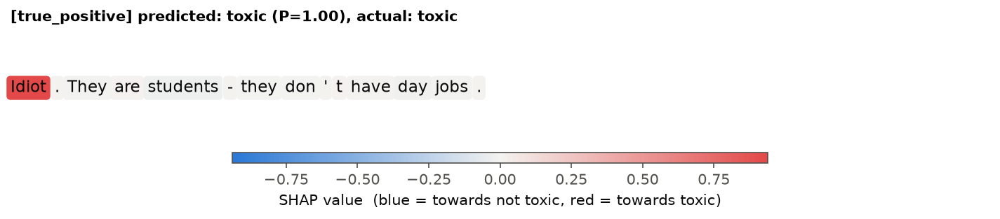

**Example 1 (true positive)**: "Says the idiot on perpetual welfare. You are a disgusting human."

Predicted toxic (P(toxic) = 0.997), actual / expected toxic.
Tokens pushing towards toxic: idiot (+0.470), disgusting (+0.369), a (+0.036), are (+0.025). Tokens pushing towards not toxic: perpetual (-0.010), welfare (-0.006), Says (-0.004), . (-0.003).

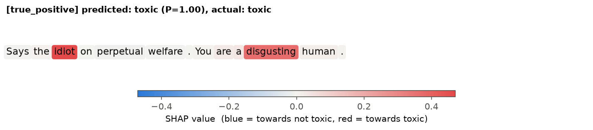

**Example 2 (true negative)**: "Not to late,  legislator's can still require the audit before approving future funding.  Hopefully they come to their senses and force the city and HART to do the audit.  Find out why costs keep going up."

Predicted not toxic (P(toxic) = 0.001), actual / expected not toxic.
Tokens pushing towards toxic: none. Tokens pushing towards not toxic: . (-0.009), audit (-0.006), funding (-0.006), audit (-0.005).

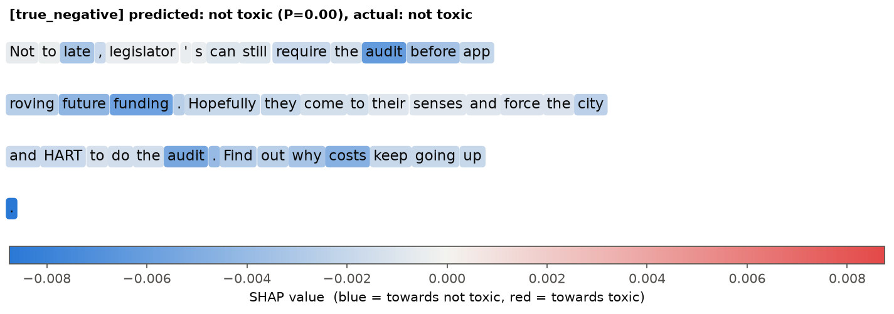

**Example 3 (true negative)**: "I disagree.  There are NO political protests that belong on the field.  Sports is supposed to be about competition, and entertainment depending on where you sit, not about politics.  As long as it continues I won't be watching."

Predicted not toxic (P(toxic) = 0.001), actual / expected not toxic.
Tokens pushing towards toxic: none. Tokens pushing towards not toxic: . (-0.006), field (-0.005), NO (-0.005), . (-0.005).

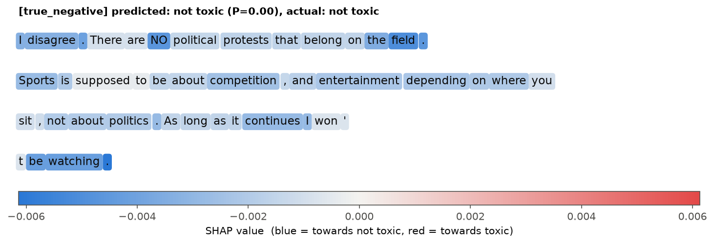

**Example 4 (false positive)**: "Richard,
You might want to read this part again: 
"Crooked Narcissist Bumbling Lunatic Buffoon has clearly overstepped his authority here."
Do you feel this is "winning?"

There will be a legal challenge."

Predicted toxic (P(toxic) = 0.992), actual / expected not toxic.
Tokens pushing towards toxic: Lunatic (+0.225), oon (+0.174), Buff (+0.169), Bum (+0.110). Tokens pushing towards not toxic: Richard (-0.003), " (-0.003), winning (-0.003), ? (-0.003).

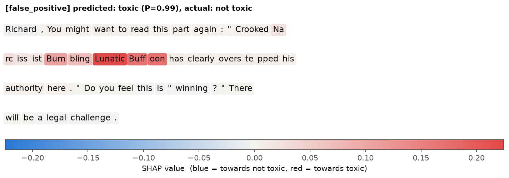

**Example 5 (false positive)**: "All 3 vehicles completely totaled. Everybody is in such a damn hurry."

Predicted toxic (P(toxic) = 0.995), actual / expected not toxic.
Tokens pushing towards toxic: damn (+0.939), such (+0.007), in (+0.006), a (+0.006). Tokens pushing towards not toxic: hurry (-0.022), totaled (-0.014), . (-0.009), Everybody (-0.007).

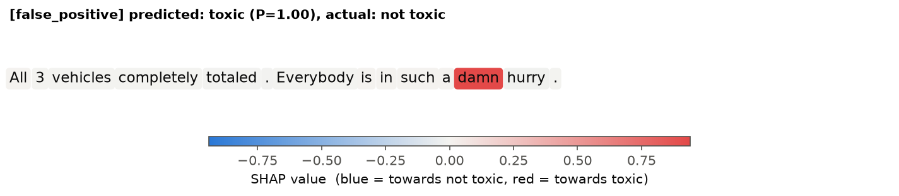

**Example 6 (false negative)**: "In serious need of an injection to put it to sleep forever."

Predicted not toxic (P(toxic) = 0.011), actual / expected toxic.
Tokens pushing towards toxic: an (+0.031), injection (+0.026), to (+0.014), of (+0.001). Tokens pushing towards not toxic: sleep (-0.049), forever (-0.045), In (-0.020), it (-0.016).

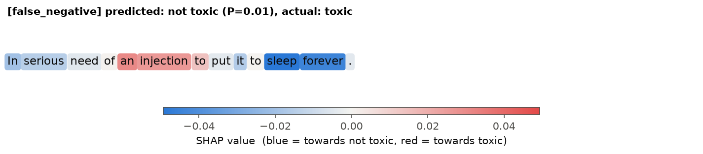

**Example 7 (false negative)**: "WTF is up with that name?

Did his parent (s) mis-spell Subaru?"

Predicted not toxic (P(toxic) = 0.002), actual / expected toxic.
Tokens pushing towards toxic: name (+0.004), with (+0.003), ( (+0.003), - (+0.002). Tokens pushing towards not toxic: ? (-0.032), ? (-0.011), parent (-0.007), Did (-0.006).

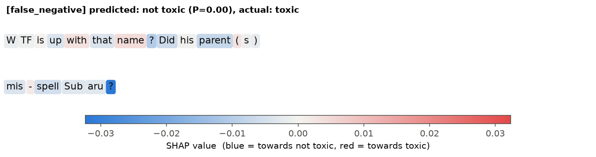

**Example 8 (real world)**: "You are an absolute idiot if you believe this nonsense."

Predicted toxic (P(toxic) = 0.997), actual / expected toxic.
Tokens pushing towards toxic: idiot (+0.416), nonsense (+0.341), this (+0.049), an (+0.021). Tokens pushing towards not toxic: if (-0.009).

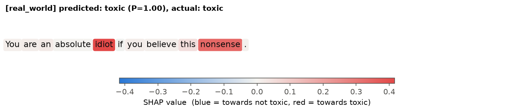

**Example 9 (real world)**: "Shut up, nobody cares about your stupid opinion."

Predicted toxic (P(toxic) = 0.997), actual / expected toxic.
Tokens pushing towards toxic: stupid (+0.481), Shut (+0.193), up (+0.182), your (+0.015). Tokens pushing towards not toxic: opinion (-0.023), about (-0.003), cares (-0.002).

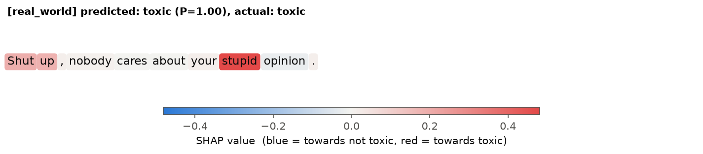

**Example 10 (real world)**: "This movie was so bad it was hilarious, I laughed the whole time."

Predicted not toxic (P(toxic) = 0.004), actual / expected not toxic.
Tokens pushing towards toxic: This (+0.014), . (+0.010), , (+0.004), was (+0.001). Tokens pushing towards not toxic: laughed (-0.023), time (-0.019), I (-0.015), hilarious (-0.014).

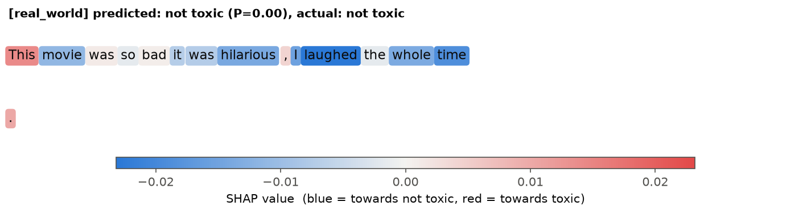

**Example 11 (real world)**: "The referee was blind tonight, worst officiating I have seen all season."

Predicted not toxic (P(toxic) = 0.013), actual / expected not toxic.
Tokens pushing towards toxic: worst (+0.098), was (+0.010), . (+0.009). Tokens pushing towards not toxic: season (-0.026), off (-0.024), ting (-0.021), referee (-0.021).

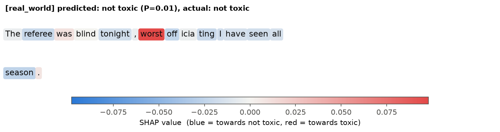

Average contribution of tokens across all explained examples:

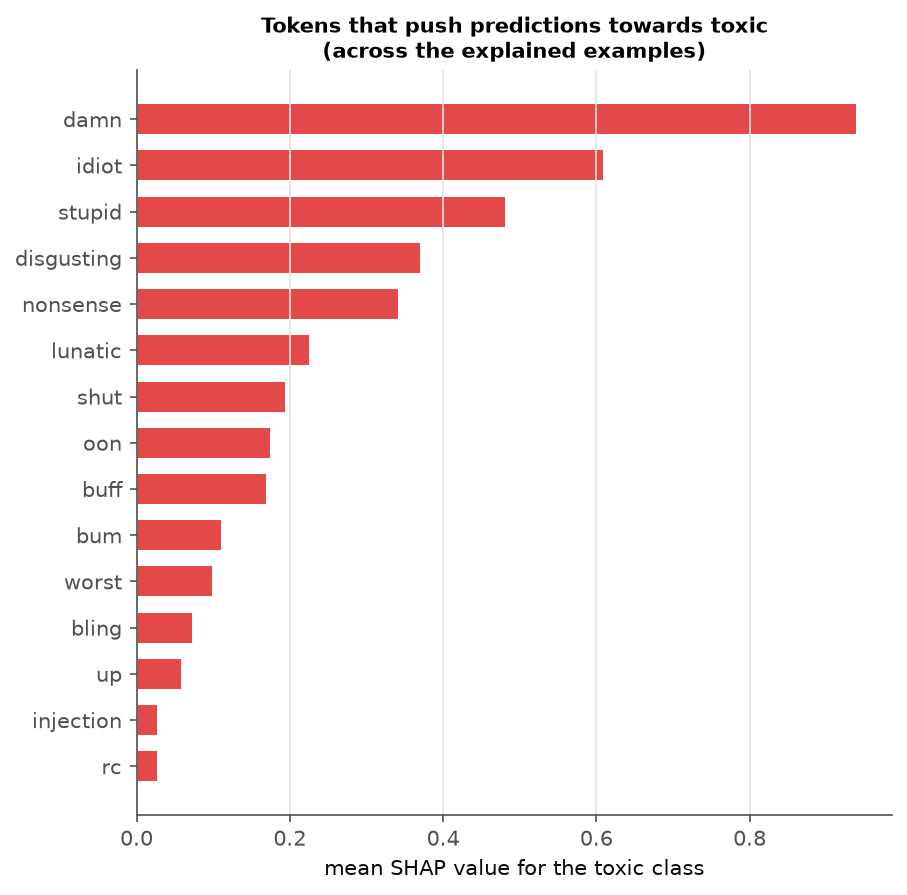

The interactive SHAP text plots for all examples are in `figures/shap_text_plots.html` (open it in a browser).
<!-- AUTO:EXPLAIN:END -->

### What the explanations show

**Correct toxic predictions depend on one or two words.** In example 0, "Idiot" alone contributes +0.938 out of a prediction of 0.997; the rest of the comment barely matters. In example 1 the push is split between "idiot" (+0.470) and "disgusting" (+0.369). The real-world insults follow the same pattern: "stupid", "Shut up", "idiot" and "nonsense" carry almost all of the weight.

**Correct non-toxic predictions have no strong token.** In examples 2 and 3 no token pushes towards toxic, and the largest contributions towards not toxic are under 0.01. Example 3 is a strongly worded political opinion ("There are NO political protests that belong on the field"), and the model correctly treats it as civil disagreement.

**False positives come from strong words used without a target.** In example 5, "Everybody is in such a damn hurry" is a complaint about traffic, but "damn" alone contributes +0.939 and the model predicts toxic with probability 0.995. In example 4, the insults ("Lunatic", "Buffoon", "Bumbling") appear inside a quotation that the commenter is criticising. The annotators judged the comment itself as not toxic, but the model has no sense of quotation and reacts to the words as if the commenter used them.

**False negatives are toxic without insult words.** Example 6, "In serious need of an injection to put it to sleep forever", is hostile through implied meaning (wishing that something be put down), but every individual word is ordinary. The largest contributions are small, and "sleep" and "forever" even push towards not toxic. Example 7 mocks someone's name, and the only strong word is "WTF", which the model gives almost no weight. In both cases the toxicity lies in the meaning of the whole sentence, not in a single word.

Together these show that the fine-tuned model has learned a strong word-level signal: it is very reliable when an insult or profanity is present and directed at someone. It is weaker in both directions when the toxic words and the toxic meaning don't line up, whether that is profanity without a target, quoted insults, or implied hostility with no insult words. The "I killed it" real-world sentence, which scored 0.406, is a milder case of the same tendency.

## 9. Project structure

```
toxicity-bert/
├── toxicity_classification.ipynb   main notebook, runs the full pipeline step by step
├── run_pipeline.py                 same pipeline from the command line
├── src/
│   ├── config.py                   all settings and presets
│   ├── data.py                     loading, sampling and labelling Civil Comments
│   ├── frozen_baseline.py          transfer learning with a frozen encoder
│   ├── finetune.py                 end-to-end fine-tuning
│   ├── tuning.py                   Optuna hyperparameter search
│   ├── explain.py                  SHAP explanations
│   ├── metrics.py                  evaluation metrics
│   ├── plots.py                    figures
│   ├── pipeline.py                 the pipeline steps
│   └── report.py                   writes results into this README
├── data/real_world_texts.csv       real-world test sentences
├── figures/                        generated figures
├── results/                        generated CSV / JSON results
└── requirements.txt
```

## 10. How to run

```bash
python -m venv .venv
# Windows: .venv\Scripts\activate      macOS / Linux: source .venv/bin/activate
pip install -r requirements.txt
```

Then either open `toxicity_classification.ipynb` and run all cells, or run:

```bash
python run_pipeline.py            # full run (GPU recommended)
python run_pipeline.py --quick    # smaller run for a CPU
```

A GPU is strongly recommended for the full run. On CPU use the quick preset. The Civil Comments download is about 400 MB and is cached by Hugging Face after the first run. Trained model weights are written to `saved_models/`, which is not committed to the repository.

## 11. Limitations

- Only a subset of Civil Comments was used (40,000 training, 5,000 validation and 10,000 test comments out of about 2 million), so the absolute scores are lower than models trained on the full dataset.
- The 0.5 toxicity threshold turns a graded score into a hard label; comments with scores near 0.5 are genuinely ambiguous even for human annotators.
- Only 4 of the 12 tuning trials completed, and they were trained on an 8,000-comment subset. The chosen hyperparameters and the importance values are therefore estimates; a longer search on more data may find a different setting.
- Each model was trained once with one random seed. Differences as small as the one between the default and tuned models are within normal run-to-run variation.
- SHAP explanations describe the model's behaviour on a handful of selected examples; they do not prove the model behaves the same way on every input.
- The model reacts strongly to individual words. As the explanations show, it can miss implied toxicity and can flag profanity or quoted insults that are not directed at anyone.
